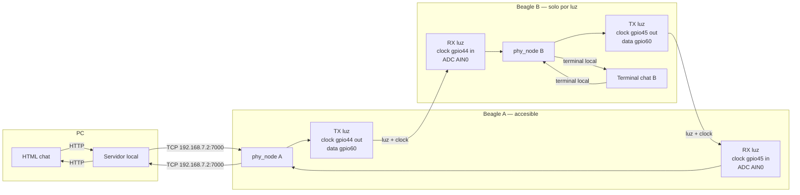
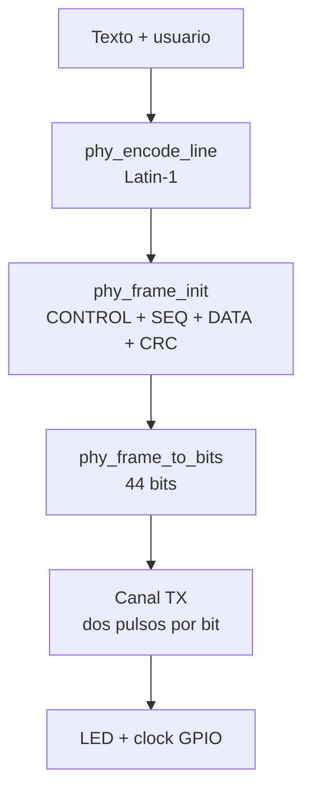
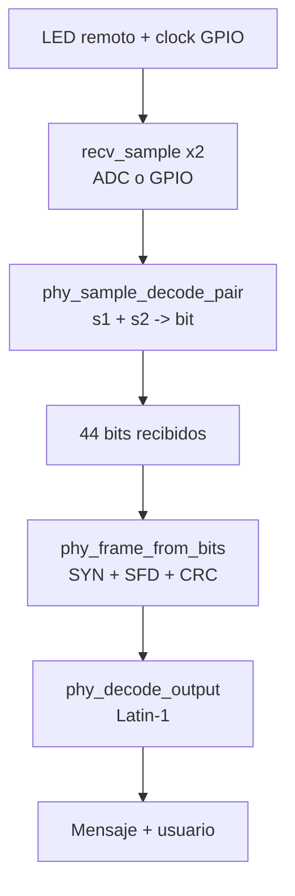

# Fases de implementación — comunicación bidireccional entre dos dispositivos

## Estado del documento

| Campo | Valor |
|---|---|
| Versión | 0.1 (plan de trabajo) |
| Fecha | 2026-11-15 |
| Objetivo | Dejar programada toda la lógica de comunicación para que mañana solo se conecten los cables |
| Alcance | Dos BeagleBone, enlace de luz bidireccional, chat en terminal y mensajes hacia el HTML |
| Fuera de alcance | RFC formal, ACK/NACK en la primera versión, canales de sonido y vibración (el receptor piezo se agregó en la fase 9) |
| Documentos relacionados | `implementacion.md`, `docs/servidores.md` |

Este documento **no es un RFC**. Es un plan de fases y una guía de conexión.
La especificación completa del protocolo se hará después.

## Estado de las fases

| Fase | Estado |
|---|---|
| Fase 0 — Contratos y configuración | Completada |
| Fase 1 — Recepción genérica con canal falso | Completada |
| Fase 2 — Canales GPIO y nodo con enlace falso | Completada |
| Fase 3 — Identidad y relay | Completada |
| Fase 4 — Gateway de la PC y HTML | Completada |
| Fase 5 — Prueba integral de software | Completada |
| Fase 6 — Conexión física y prueba real | Pendiente |
| Fase 7 — ACK/NACK y retransmisión | Completada en software |
| Fase 8 — Handshake de conexión | Completada en software |
| Fase 9 — Receptor piezoeléctrico | Completada en software |

## 1. Decisiones cerradas

| Tema | Decisión |
|---|---|
| Equipos | Dos computadoras distintas: Beagle A y Beagle B |
| Acceso desde la PC | Solo Beagle A es accesible por red/USB |
| Comunicación entre equipos | Por luz, con reloj directo por GPIO |
| Terminal del chat | B reutiliza la misma terminal que A, ejecutada localmente en B |
| Clock de recepción en B | gpio44 (P8_12), entrada |
| Clock de transmisión en B | gpio45 (P8_11), salida; confirmado y libre |
| Clock de transmisión en A | gpio44 (P8_12), salida |
| Clock de recepción en A | gpio45 (P8_11), entrada |
| Dato de transmisión | gpio60 (P9_12), LED |
| Dato de recepción | AIN0 (P9_39), ADC |
| Pulsos por bit | Dos pulsos por bit |
| Codificación | Latin-1 para el chat |
| ACK/NACK | Se dejan para una fase posterior |
| Identidad | El nombre de usuario se guarda al iniciar la conexión y viaja al otro equipo |
| Transporte PC ↔ A | TCP en la primera versión; UDP queda documentado como alternativa |
| Servidor Python en A | Se reemplaza por el nodo C `phy_node`; queda documentado en la fase 3 |

### Reparto de responsabilidades

- **PC**: interfaz HTML, polling, gateway hacia A, visualización del chat.
- **Beagle A**: nodo C, enlace de luz, relay entre la PC y B.
- **Beagle B**: nodo C y terminal local del chat.
- **Lógica de trama**: compartida por A y B; no se duplica por canal.

## 2. Topología entre dispositivos



La PC no habla directamente con B. A recibe los mensajes que vienen de la PC,
los transmite por luz, y a la vez recibe lo que B transmite para entregarlo a
la PC por TCP.

## 3. Pipeline de datos

### 3.1 Transmisión



### 3.2 Recepción



### 3.3 Recorrido completo

```text
PC HTML
  -> servidor local
  -> TCP 7000
  -> phy_node A
  -> phy_tx
  -> canal TX luz de A
  -> canal RX luz de B
  -> phy_rx
  -> phy_node B
  -> terminal de B

Terminal de B
  -> phy_node B
  -> canal TX luz de B
  -> canal RX luz de A
  -> phy_node A
  -> cola de recibidos
  -> servidor local de la PC
  -> HTML
```

## 4. Vista del protocolo (borrador, no RFC)

### 4.1 Trama PHY actual

```text
SYN 16 | SFD 4 | CONTROL 4 | SEQ 4 | DATA 8 | CRC 8
```

Total: 44 bits. Se mantiene la trama existente de `c/src/frame.c`.

- SYN: `0xAAAA`.
- SFD: `0xD`.
- CONTROL: DATA, ACK, NACK, HELLO, CONFIG, STATUS, ABORT.
- SEQ: 4 bits circulares.
- DATA: 8 bits.
- CRC: 8 bits sobre CONTROL + SEQ + DATA.

### 4.2 Dos pulsos por bit

Cada bit se transmite con dos pulsos de reloj. En recepción se toman dos
muestras `(s1, s2)` y se decodifica con `phy_sample_decode_pair()`.

```text
bit -> reloj alto, muestra s1, reloj bajo, reloj alto, muestra s2, reloj bajo
```

### 4.3 Identidad de usuario

El nombre de usuario se guarda al iniciar la conexión. Para que B lo conozca,
la identidad tiene que viajar por el enlace de luz.

Propuesta sin cambiar el tamaño de trama:

1. Al iniciar una sesión o antes de un mensaje, enviar una ráfaga de frames
   `CONTROL=HELLO` con los bytes del nombre de usuario, terminados en `\n`.
2. B acumula esos bytes, guarda el usuario de la sesión y luego recibe los
   frames `CONTROL=DATA`.
3. Mientras no exista ACK/NACK, repetir el `HELLO` al comienzo de cada mensaje
   o al inicio de cada conexión, para no depender de un handshake frágil.

Ejemplo:

```text
HELLO "ana\n"   -> B guarda usuario=ana
DATA  "hola\n"  -> B muestra "ana: hola"
```

En la API TCP de la PC el usuario puede viajar en el encabezado de la
conexión o en el JSON:

```json
{"user": "ana", "text": "hola"}
```

### 4.4 Retransmisión

La trama ya tiene `SEQ`, `ACK` y `NACK`, así que el formato no necesita
cambios para una retransmisión futura.

- **PC ↔ A:** TCP ya retransmite, ordena y conserva la conexión.
- **A ↔ B por luz:** en la primera versión no hay ACK/NACK. La retransmisión
  queda para la fase 7, con stop-and-wait, timeout y reintentos.
- **Usuario:** si se repite el `HELLO` al inicio de cada mensaje, una pérdida
  no deja la sesión sin identidad.

### 4.5 TCP vs UDP para la conexión PC ↔ A

| Criterio | TCP | UDP |
|---|---|---|
| Entrega | Confiable, sin pérdidas | No confiable |
| Orden | Garantizado | Lo debe resolver la aplicación |
| Retransmisión | Automática | Hay que implementarla |
| Conexión | Conserva estado y usuario por conexión | Sin conexión; requiere sesión propia |
| Latencia | Mayor overhead y head-of-line blocking | Menor latencia y sin head-of-line blocking |
| Duplicados | Los maneja el transporte | Hay que detectarlos |
| Uso recomendado | Chat y control en la primera versión | Telemetría o streaming de baja latencia |
| Complejidad | Baja | Alta: orden, ACK, timeout, reenvío, sesión |

Para este chat, **TCP es la opción recomendada** porque los mensajes son
cortos, el orden importa y no queremos implementar retransmisión en la capa de
aplicación. UDP queda como alternativa futura si se prioriza latencia sobre
confiabilidad.

## 5. Conexiones

Esta sección describe qué pin debe ir conectado a qué para que los canales
funcionen. Los números de GPIO son de la BeagleBone Black.

### 5.1 Resumen de pines

| Señal | Beagle A | Beagle B |
|---|---|---|
| Reloj TX (salida) | P8_12 · gpio44 | P8_11 · gpio45 |
| Reloj RX (entrada) | P8_11 · gpio45 | P8_12 · gpio44 |
| Dato TX (LED) | P9_12 · gpio60 | P9_12 · gpio60 |
| Dato RX (luz) | P9_39 · AIN0 | P9_39 · AIN0 |

Los relojes se cruzan: la salida de una placa entra en la otra. El dato de
salida es un LED y el de entrada es un sensor de luz.

### 5.2 Cableado entre equipos

```text
A P8_12 (gpio44 salida)  ->  B P8_12 (gpio44 entrada)
B P8_11 (gpio45 salida)  ->  A P8_11 (gpio45 entrada)

A P9_12 (gpio60 LED)     ->  B P9_39 (AIN0, sensor de luz)
B P9_12 (gpio60 LED)     ->  A P9_39 (AIN0, sensor de luz)

A GND                    ->  B GND
```

El reloj de A llega al reloj de recepción de B. El reloj de B llega al reloj
de recepción de A. Cada LED debe iluminar el sensor del equipo contrario.

### 5.3 Alimentación y ADC

| Uso | Pin |
|---|---|
| Alimentación ADC | P9_32 (1.8 V) |
| Masa analógica | P9_34 (GNDA) |
| Masa común | GND de ambas placas |

Reglas:

- El ADC de la Beagle no tolera 5 V. No conectar la salida del sensor a 5 V.
- Usar la referencia de 1.8 V de P9_32 para el divisor o el sensor.
- Unir las tierras de ambos equipos; sin GND común la luz y el reloj no son
  confiables.
- Verificar la polaridad del LED y del fototransistor/fotodiodo.
- Ajustar los umbrales `ON`/`OFF` con la luz ambiente real.

### 5.4 Red y terminal

- La PC se conecta a **Beagle A** por USB o red.
- Beagle B **no es accesible desde la PC**; su terminal se ejecuta localmente
  en B (consola física, serial o acceso local disponible en ese equipo).
- La comunicación PC ↔ A usa TCP en `192.168.7.2:7000` en la primera versión.
- La comunicación A ↔ B usa el enlace de luz. No hay conexión de red entre la
  PC y B.

## 6. Componentes de software

### 6.1 Reutilización

| Módulo | Uso |
|---|---|
| `c/src/frame.c` | Construir y validar tramas de 44 bits |
| `c/src/crc8.c` | CRC-8 |
| `c/src/presentation.c` | Codificación Latin-1 |
| `c/src/phy_tx.c` | Mensaje -> bytes -> tramas |
| `c/src/phy_channel.c` | Interfaz TX genérica |
| `c/src/phy_sample.c` | Clasificación y decodificación de dos muestras |
| `c/src/phy_analog.c` | Lectura del ADC |
| `c/src/phy_gpio.c` | Entrada/salida GPIO |
| `c/src/net.c` | API TCP del nodo |

### 6.2 Módulos nuevos

| Archivo | Función |
|---|---|
| `c/include/phy_rx_channel.h` + `c/src/phy_rx_channel.c` | Interfaz RX genérica |
| `c/include/phy_light_rx_channel.h` + `c/src/phy_light_rx_channel.c` | Recepción por luz y ADC |
| `c/include/phy_rx.h` + `c/src/phy_rx.c` | Sincronización, 44 bits, CRC y mensaje |
| `c/include/phy_gpio_tx_channel.h` + `c/src/phy_gpio_tx_channel.c` | TX GPIO con dos pulsos por bit |
| `c/include/phy_fake_link.h` + `c/src/phy_fake_link.c` | Enlace falso bidireccional para probar A y B en la PC |
| `c/tools/phy_node.c` | Daemon del nodo: TX, RX, API y chat |
| `config/node_a.json` | Pines y rol de A |
| `config/node_b.json` | Pines y rol de B |

### 6.3 Interfaz RX

```c
typedef struct phy_rx_channel phy_rx_channel_t;

typedef struct {
    const char *name;
    int (*wait_idle)(phy_rx_channel_t *channel, int timeout_ms);
    int (*recv_sample)(phy_rx_channel_t *channel, int *sample, int timeout_ms);
    void (*close)(phy_rx_channel_t *channel);
} phy_rx_channel_ops_t;

struct phy_rx_channel {
    const phy_rx_channel_ops_t *ops;
    void *context;
};
```

Cada canal implementa solo:

- `wait_idle`: espera el reloj en bajo el tiempo suficiente.
- `recv_sample`: espera un pulso, deja estabilizar y devuelve `0` o `1`.

La lógica de trama, CRC y mensaje queda en `phy_rx.c`, compartida por todos los
canales.

### 6.4 API del nodo

| Comando | Función |
|---|---|
| `PING` | Verificar conexión |
| `BITS <bits>` | Enviar bits crudos, conservando el modo actual |
| `SEND <usuario> <texto>` | Armar tramas y transmitir |
| `POLL <since>` | Mensajes y eventos nuevos |
| `STATUS` | Estado del enlace |

La API se implementa con `phy_net` para no duplicar el manejo de sockets.

### 6.5 Contratos de encabezado y eventos

Encabezado de usuario en la conexión TCP (primera línea):

```text
HELLO <usuario>
```

A partir de ahí, el nodo asocia todas las tramas de esa conexión al usuario.
Por el enlace de luz, el usuario viaja con frames `CONTROL=HELLO` seguidos de
los bytes del nombre, terminados en `\n`.

Formato de eventos devueltos por `POLL`, una línea por evento:

```text
MESSAGE <id> <usuario> <texto>
TX <id> frame=<n>/<total> control=<tipo> seq=<n> data=<byte> crc=<crc>
RX <id> control=<tipo> seq=<n> data=<byte> crc=<crc> status=<ok|error>
ERROR <id> <descripcion>
```

Los eventos se recortan con `since` para no repetir los ya entregados.

### 6.6 Concurrencia

El nodo necesita:

- Hilo de control TCP: atiende `PING`, `BITS`, `SEND`, `POLL`, `STATUS`.
- Hilo de recepción: `wait_idle`, muestreo, armado de mensajes.
- Cola de transmisión: evita bloquear el control mientras se envían tramas.

La recepción debe seguir funcionando mientras el equipo transmite.

## 7. Fases

### Fase 0 — Contratos y configuración (hoy, sin hardware)

Objetivo: fijar roles, pines y formato de eventos antes de programar.

Tareas:

- Crear `config/node_a.json` y `config/node_b.json` con los pines de la tabla.
- Definir el rol A/B y el nombre del nodo.
- Definir el formato de eventos de `POLL`.
- Definir el encabezado de usuario de la API.
- Documentar que `beagle_server.py` se reemplaza por `phy_node`.

Criterio de aceptación:

- Las dos configuraciones existen y describen pines distintos para A y B.
- No hay ambigüedad de dirección de clock.

### Fase 1 — Recepción genérica con canal falso (hoy, sin hardware)

Objetivo: programar y probar la lógica de trama sin ADC ni GPIO.

Tareas:

- Crear `phy_rx_channel` con `wait_idle` y `recv_sample`.
- Crear `phy_rx_frame()`:
  - espera idle;
  - consume 44 bits con dos muestras por bit;
  - decodifica el par;
  - valida con `phy_frame_from_bits`.
- Crear `phy_rx_message()`:
  - recibe frames;
  - decodifica Latin-1 con `phy_decode_output`;
  - acumula hasta `\n`.
- Crear un canal falso que entrega bits conocidos.

Criterio de aceptación:

- Un frame DATA conocido se decodifica con SEQ, DATA y CRC correctos.
- Un CRC alterado se rechaza.
- Un mensaje de varios frames se reconstruye completo.
- No se usa hardware.

### Fase 2 — Canales GPIO y nodo con enlace falso (hoy, sin hardware)

Objetivo: tener el nodo completo usando un enlace simulado.

Tareas:

- Crear `phy_gpio_tx_channel` reutilizando `phy_gpio`.
  - `send_bits` mantiene dos pulsos por bit.
- Crear `phy_light_rx_channel`:
  - `wait_idle` y `recv_sample` con `phy_analog_read_average` y
    `phy_sample_classify`.
  - Dejar preparado el uso de `phy_gpio_read` para el clock de entrada.
- Crear `phy_node` con:
  - hilo de recepción;
  - cola de transmisión;
  - API TCP.
- Implementar un canal falso bidireccional para probar A y B en la misma PC.

Criterio de aceptación:

- `SEND` desde A llega como mensaje a B usando el canal falso.
- `SEND` desde B llega como mensaje a A usando el canal falso.
- `BITS` sigue funcionando.
- La recepción no se bloquea mientras se transmite.

### Fase 3 — Identidad y relay (hoy)

Objetivo: que el nombre de usuario viaje con el mensaje y que A haga de relay.

Tareas:

- Guardar el usuario al iniciar la conexión TCP.
- Enviar el usuario por el enlace de luz con frames `HELLO`.
- Asociar el usuario al mensaje recibido en B.
- En A, encolar los mensajes recibidos de B para que la PC los consulte.
- Reemplazar `beagle_server.py` por `phy_node` en A.
  - `BITS` se mantiene dentro de `phy_node`.
  - El puerto de la API queda en `7000`.
- Dejar `c/phy_light_tx` como herramienta de diagnóstico; el camino del chat
  usa `phy_node`, no el emisor suelto de la PC.

Criterio de aceptación:

- B muestra `usuario: mensaje`.
- A entrega a la PC los mensajes recibidos de B.
- El modo `BITS` sigue disponible desde el nodo.

### Fase 4 — Gateway de la PC y HTML (hoy)

Objetivo: que los mensajes de ambos equipos lleguen al HTML.

Tareas:

- Cambiar el servidor local para hablar con la API del nodo de A.
- Agregar `POST /api/message` con `{"user":"ana","text":"hola"}`.
- Agregar `GET /api/inbox?since=N` para polling.
- Mantener `/api/bits`.
- En el HTML:
  - pedir el nombre de usuario al iniciar;
  - mostrar mensajes con origen;
  - hacer polling del inbox;
  - conservar los modos `Tramas PHY` y `Bits sin trama`.

Criterio de aceptación:

- Un mensaje enviado desde el HTML aparece en la terminal de B.
- Un mensaje enviado desde la terminal de B aparece en el HTML.
- El nombre de usuario se muestra correctamente.

### Fase 5 — Prueba integral de software (hoy)

Objetivo: validar todo el recorrido sin conectar hardware.

Tareas:

- Levantar A y B con canales falsos.
- Probar:
  - HTML -> A -> B -> terminal;
  - terminal B -> A -> HTML;
  - mensaje con acentos en Latin-1;
  - usuario distinto;
  - frame corrupto;
  - trama incompleta.
- Medir el tiempo con dos pulsos por bit.

Criterio de aceptación:

- El chat funciona en ambos sentidos.
- Los mensajes llegan al HTML.
- Los errores de CRC se registran sin romper el nodo.

### Fase 6 — Conexión física y prueba real (mañana)

Objetivo: cambiar los canales falsos por GPIO/ADC y conectar los equipos.

Tareas:

- Cargar `config/node_a.json` en A y `config/node_b.json` en B.
- Conectar según la sección 5.
- Verificar GND común y referencia de ADC.
- Calibrar umbrales `ON`/`OFF`.
- Probar `PING`, `BITS`, `SEND` y `POLL`.
- Ajustar `clock_hz` si hay errores.

Criterio de aceptación:

- A transmite y B recibe.
- B transmite y A recibe.
- El HTML muestra los mensajes de ambos.
- No se requiere cambiar código, solo configuración y cables.

### Fase 7 — ACK/NACK y retransmisión (completada en software)

Objetivo: agregar confiabilidad al enlace de luz.

Estado: implementado y probado con enlace falso. Pendiente la validación sobre
hardware real junto con la fase 6.

Tareas:

- Enviar `ACK`/`NACK` con el SEQ recibido.
- Implementar timeout y reintentos.
- Deduplicar por SEQ.
- Repetir `HELLO` si la sesión no está confirmada.

Criterio de aceptación:

- Un frame corrupto provoca `NACK`.
- El emisor retransmite y el receptor entrega una sola vez.
- El usuario no necesita cambios en la interfaz.

### Fase 8 — Handshake de conexión (completada en software)

Objetivo: establecer la conexión antes de transmitir mensajes.

Tareas:

- Agregar controles `SYN` y `SYN-ACK`.
- Al arrancar, A inicia `SYN` y B responde `SYN-ACK`.
- A confirma con `ACK` y ambos pasan a `CONNECTED`.
- Reutilizar timeout, reintentos y la espera de control.
- `--no-handshake` para diagnóstico y compatibilidad.

Criterio de aceptación:

- A y B quedan en `state=connected` antes de transmitir.
- Si B no está lista, A reintenta cada segundo.
- Los mensajes siguen llegando en ambos sentidos después del handshake.

### Fase 9 — Receptor piezoeléctrico (completada en software)

Objetivo: agregar un segundo medio de recepción acústica sin tocar el enlace
óptico.

Tareas:

- Implementar `phy_piezo_rx_channel` sobre AIN1/P9_40 con la misma interfaz
  `phy_rx_channel_t`.
- Separar adquisición, DSP de línea base/envolvente, histéresis y
  decodificación.
- Agregar `--rx-medium piezo` y `--piezo-ain`; el defecto sigue siendo luz.
- Agregar `phy_piezo_tx_channel` opcional sobre gpio50/P9_14.
- Probar el DSP con `make test-piezo` y mantener `make test` sin regresiones.

Criterio de aceptación:

- El enlace óptico funciona igual sin cambiar opciones.
- `--rx-medium piezo` usa AIN1 y no AIN0.
- El protocolo, ACK/NACK, handshake y API no se modifican.
- La señal analógica queda limitada a 0..1.8 V antes del ADC.

La etapa eléctrica, pines, justificación de AIN1 y análisis de ruido están en
`docs/piezo.md`.

## 8. Qué se programa hoy y qué se conecta mañana

### Hoy

- Fases 0 a 5.
- Todo se prueba con canales falsos y procesos locales.
- No se toca el hardware.
- Se deja `phy_node` compilando y con la API estable.

### Mañana

- Fase 6.
- Solo se conectan cables, se cargan configuraciones y se calibran umbrales.
- Si algo falla, se ajusta `clock_hz`, pines o umbrales, no la lógica.

## 9. Riesgos y pendientes

| Riesgo | Mitigación |
|---|---|
| gpio45 ocupado o con pinmux incorrecto | Verificar P8_11 antes de conectar |
| Ruido en el ADC | Calibrar umbrales y usar promedio |
| Pérdida de frames sin ACK | Aceptar en la primera versión; agregar ACK/NACK en fase 7 |
| Usuario perdido si se pierde el HELLO | Repetir HELLO al inicio de cada mensaje |
| B sin acceso desde la PC | Terminal local en B; A hace de relay |
| Bloqueo del nodo al transmitir | Cola de transmisión e hilo de recepción separado |
| Diferencias de tiempo entre equipos | Reloj source-synchronous y dos pulsos por bit |

## 10. Orden recomendado de trabajo

1. Fase 0: configuraciones y contratos.
2. Fase 1: `phy_rx` con canal falso.
3. Fase 2: `phy_node` con enlace falso.
4. Fase 3: usuario, relay y reemplazo de `beagle_server.py`.
5. Fase 4: gateway y HTML.
6. Fase 5: prueba integral sin hardware.
7. Fase 6: conectar y probar.
8. Fase 7: ACK/NACK y retransmisión.
9. Fase 8: handshake de conexión.
10. Fase 9: receptor piezoeléctrico sobre AIN1.
